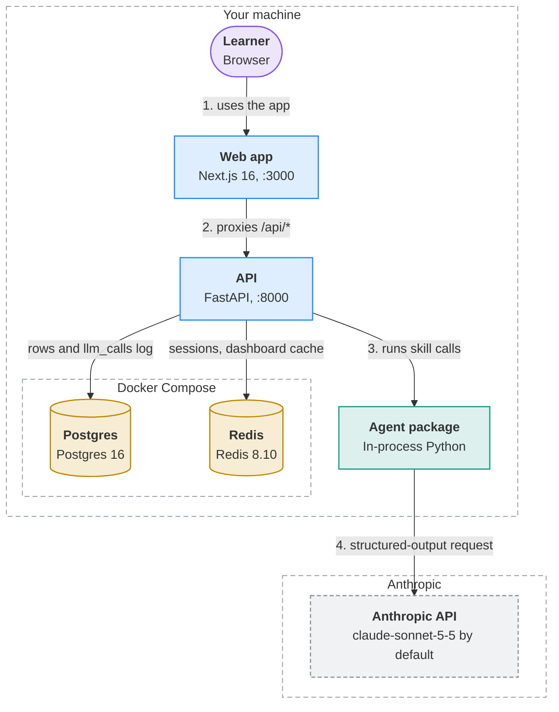

# Instructor

An AI instructor that diagnoses where you really are, maps the concepts and prerequisites you need, teaches them one at a time with zero-hint quizzes, and re-plans as it learns what you actually know, not what you say you know. Org courses can be grounded in internal docs.

> **Core rule:** understanding is demonstrated, not declared. Mastery is only recorded from a graded retrieval attempt.

**Status:** Phase 1 under active development. See [`BUILD_LOG.md`](BUILD_LOG.md).

<!-- visualizer:start path=docs/architecture/architecture.json hash=63bd6b97e86b -->
## Architecture



Components, data flows and where state lives: [docs/architecture/ARCHITECTURE.md](docs/architecture/ARCHITECTURE.md)
<!-- visualizer:end -->

## Docs
- [Learning design](docs/learning-design.md): how the instructor teaches
- [Build brief](docs/build-brief.md): Phase 1 scope
- [Decisions](docs/decisions.md): ADRs
- [Build plan](docs/build-plan.md): how Phase 1 is being built
- [Data model](docs/data-model.md): every table, JSONB shape and Redis key, with examples
- [Roadmap](docs/roadmap.md): the full product vision

## Quickstart
Requires Docker, [uv](https://docs.astral.sh/uv/), and Node 24+.

```bash
cp .env.example .env      # add ANTHROPIC_API_KEY
make install              # backend + web dependencies
make up                   # Postgres 16 + Redis 8 in Docker
make doctor               # health checks
make dev                  # FastAPI on :8000, Next.js on :3000
```

Open http://localhost:3000. Run `make help` for all commands.

## License
Source-available under the [PolyForm Noncommercial License 1.0.0](LICENSE). You may view, run and modify it for noncommercial purposes. Commercial use is not permitted. This project does not accept outside contributions.
