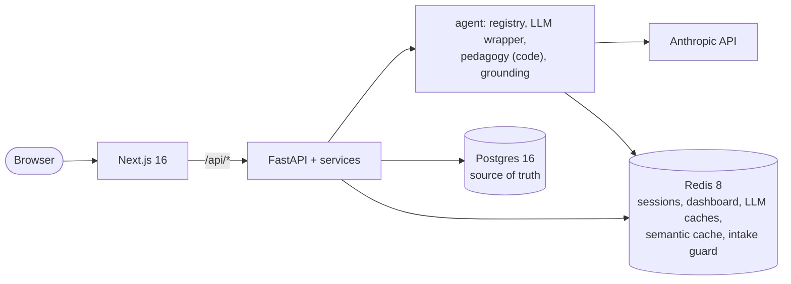

# Instructor

An AI instructor that diagnoses where you really are, maps the concepts and prerequisites you need, teaches them one at a time with zero-hint quizzes, and re-plans as it learns what you actually know, not what you say you know. Org courses can be grounded in internal docs.

> **Core rule:** understanding is demonstrated, not declared. Mastery is only recorded from a graded retrieval attempt.

**Status:** Phase 1 (`v0.1.0`). How it was built: [`BUILD_LOG.md`](BUILD_LOG.md) and [docs/ai-workflow.md](docs/ai-workflow.md).

## What it does
- **J1, create a course:** a diagnostic that re-levels you (with the reason) when your answers don't match your claim, then a concept map with prerequisites and a time budget you can edit.
- **J2, learn, check, adapt:** one concept at a time behind a prerequisite gate; streamed lessons; zero-hint quizzes graded 1–4; mastery bands and FSRS review dates; a new plan version, with the reason, whenever the rules adapt.
- **J3, org courses:** an admin builds a course from internal docs; lessons cite the docs with verbatim quotes and say when something isn't covered.
- **Redis 8:** sessions, a cache-aside dashboard, an exact LLM cache, a RedisVL semantic LLM cache tuned by an eval, and a RedisVL intake guard.

## Architecture



Components, the learning-loop sequence and where state lives: [docs/architecture.md](docs/architecture.md).

## Docs
- [Overview](docs/overview.md): the problem, the three journeys, tradeoffs, known gaps
- [Walkthrough](docs/walkthrough.md): the click path through J1–J3 with the sample data
- [Architecture](docs/architecture.md): components, the learning loop, where state lives
- [How it was built with AI](docs/ai-workflow.md)
- [Learning design](docs/learning-design.md): how the instructor teaches
- [Build brief](docs/build-brief.md): Phase 1 scope
- [Decisions](docs/decisions.md): ADRs
- [Build plan](docs/build-plan.md): how Phase 1 is being built
- [Data model](docs/data-model.md): every table, JSONB shape and Redis key, with examples
- [Roadmap](docs/roadmap.md): the full product vision

## Quickstart
Requires Docker, [uv](https://docs.astral.sh/uv/), and Node 24+.

```bash
cp .env.example .env      # add ANTHROPIC_API_KEY
make install              # backend + web dependencies
make up                   # Postgres 16 + Redis 8 in Docker
make doctor               # health checks
make reset                # load the sample learners and courses
make warm-cache           # optional: pre-generate the sample lessons (~$0.20)
make dev                  # FastAPI on :8000, Next.js on :3000
```

Open http://localhost:3000 and continue as kyle, dana or priya ([walkthrough](docs/walkthrough.md)). `make test` runs the deterministic tests; `make evals` runs the live eval harness (~$0.60). Run `make help` for all commands.

## License
Source-available under the [PolyForm Noncommercial License 1.0.0](LICENSE). You may view, run and modify it for noncommercial purposes. Commercial use is not permitted. This project does not accept outside contributions.
