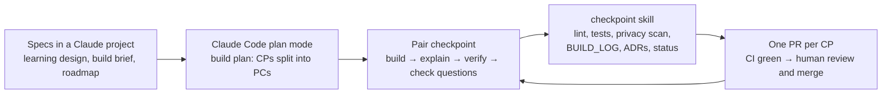

# How this was built with AI

Instructor was built by one developer pair-programming with Claude Code, over a few days of checkpoints. The goal was working software *and* a deep understanding of every component, so the process is built around review, not speed alone. The full record is [`BUILD_LOG.md`](../BUILD_LOG.md); the decisions are [`decisions.md`](decisions.md).

## The workflow

- **Specs first.** The learning design (how it teaches), the build brief (Phase 1 scope) and the roadmap were written before any code. Pedagogy rules win; changing one needs an ADR.
- **Pair checkpoints (PC).** Each checkpoint (CP) is split into PCs that end with a fixed summary: what was built, the architecture if it changed, a small task for the human against a test that was already written, exact verify steps, and two or three "why is it built this way" questions. Later checkpoints ran in a faster mode, with the AI building the tasks and the answers kept for review.
- **`CLAUDE.md`** holds the hard rules (public repo, no secrets, skills do language and code does decisions, every LLM call through the wrapper, never cache learner-specific calls, sandboxed HTML), the conventions, and the resume-from-here steps, so every new session starts from the same ground.
- **Project skills** encode repeated procedures: `checkpoint` (checks, privacy scan, build log, ADRs, status, PR), `adr` (the decision shape), `new-instructor-skill` (scaffold a product skill and test that the registry loads it), and `reset-sample-data`.
- **Current docs, not memory.** Before writing integration code, the AI loaded the API reference (`claude-api` skill) and read the installed library sources (RedisVL, fsrs, Next.js 16's bundled docs). Several designs changed because of it (below).
- **One branch and PR per checkpoint.** CI (lint, types, tests, a stale-OpenAPI check, a migration drift check) runs on every push. The human reviews and merges; the AI never merges.

## Where the AI was wrong, or was corrected

From the build log, the ones that changed the design:

- **Plan vs. the current API (PC1.1).** The plan said "structured output via forced tool use". Checking current docs first showed that's a 400 on today's models, so the wrapper uses `output_config.format` before any code depended on the old pattern (ADR-0013).
- **Native citations (PC4.2).** The first idea was the API's Citations feature; the docs showed it can't be combined with structured output, so citations became our own fields with verbatim quotes that code checks against the section the model saw (ADR-0029).
- **Library defaults (PC2.1).** Reading the installed `fsrs` source showed flashcard-scale defaults: a good first quiz would have been "due" ten minutes later. Fix: a day-scale scheduler (ADR-0018).
- **Redis 8 drops every index on FLUSHDB (CP3).** The test setup flushed its own DB and silently broke the running dev server's search indexes; found when the human's verification showed indexes vanishing. Now nothing flushes (ADR-0019).
- **Live runs catch what fakes can't.** The first assessment outputs passed every assert but promised a retake that doesn't exist; the first live quiz asked learners to "apply it to the situation described" without describing it. Asserts check fields; reading the words caught both (PC1.2, PC2.4).
- **A rule the tests missed (PC2.6).** The human overrode a locked concept, then failed it: the inserted remediation sat locked behind the gate already skipped. A real walkthrough found it; a test now covers it.
- **Human labels vs. the grader (CP5).** Every grader disagreement scored one point lower than the human label, and reading them showed some labels contradicted the item's own rubric. The prompt wasn't tuned to fit eight answers.
- **Process slips.** A commit script that didn't stop on failing lint (now chained), a test server started on a port that was in use, a formatter run that restyled unrelated files, an overclaim that the type checker would catch a missing `await` (it didn't; pytest now fails on un-awaited coroutines). Each became a rule in `CLAUDE.md` or a skill.

## What worked

- Small checkpoints with verify steps and "why" questions: the human could explain each component, and most real bugs were found in the human's verification, not by the AI's tests.
- Decisions written down as they were made (31 ADRs), so later sessions didn't re-litigate them.
- Measuring before deciding: the semantic threshold, the SSE buffering fix and the eval numbers all came from runs, not guesses.

## What we'd do differently

- Run a live end-to-end pass earlier in each checkpoint: several bugs only showed up in a real browser or a real model output.
- Start the human-labelled sets (grader answers, grounding claims) at the beginning, so the judges are validated by the time they're used.
- Write the sample data and the walkthrough alongside the features instead of at the end.
