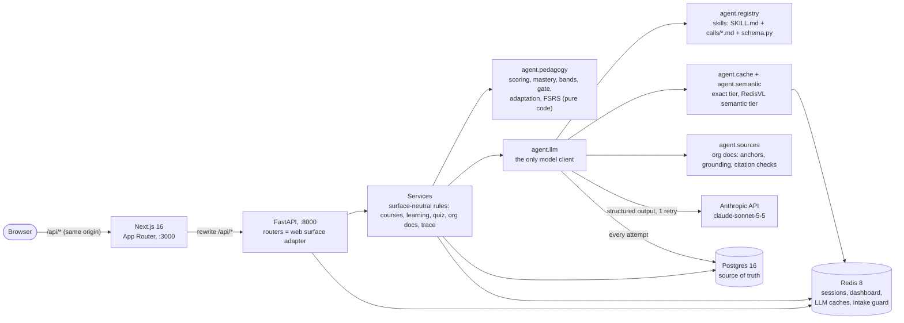
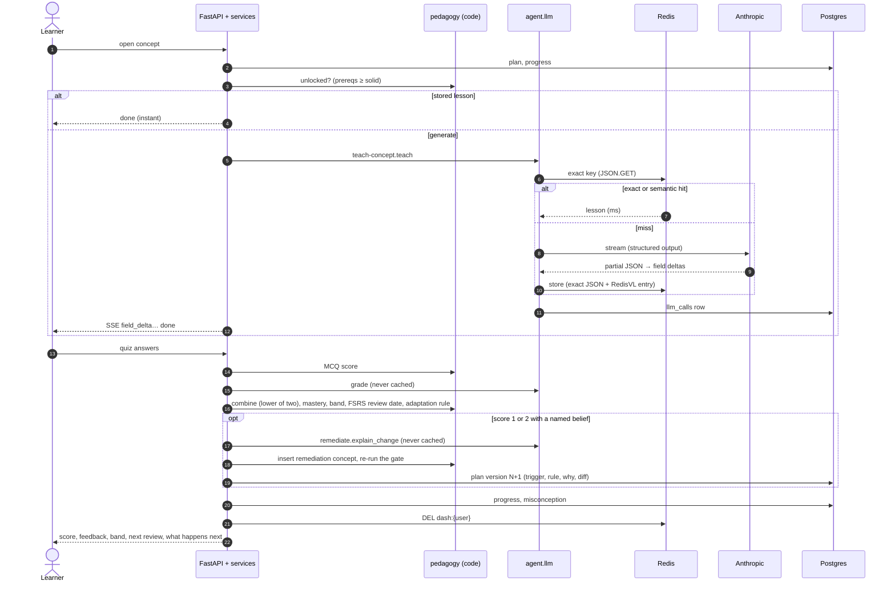

# Architecture

How Instructor is put together in Phase 1: the components, the learning loop as a sequence, where state lives, and the four ways it uses Redis. Decisions are linked to their ADRs in [`decisions.md`](decisions.md); every table, JSONB shape and key is in [`data-model.md`](data-model.md).

A generated overview with the three main request flows, rendered from a reviewed model, is in [`architecture/ARCHITECTURE.md`](architecture/ARCHITECTURE.md). This page is the hand-written explanation; the two are kept consistent.

## Components

- **Skills do language; code does decisions.** A skill writes text (a probe, a map, a lesson, a quiz, a grade's feedback, the "why" of a re-plan). Every decision (score, mastery, band, unlock, adaptation rule, review date) is a pure function in `agent/pedagogy.py` with unit tests.
- **One wrapper for every model call** (`agent/llm.py`): structured output validated by the call's Pydantic model, one retry that feeds back the validation error, every attempt logged to `llm_calls` (tokens, latency, cost, cache result) (ADR-0013).
- **Skills are folders** under `backend/agent/skills/`: `diagnose`, `map-concepts`, `teach-concept`, `design-assessment`, `grade`, `remediate`, the `ground-in-sources` modifier, and the eval-only `judge-grounding`. Frontmatter declares each call's cache policy, token budget and effort; the prompt version is the skill version plus a hash of its prompt files.
- **Surfaces are thin.** The FastAPI routers only adapt HTTP (including SSE); ownership, the unlock gate and the rules live in services, so a later MCP surface reuses them.
- **LLM HTML is sandboxed.** The seeded prototype renders in an iframe with `srcdoc` and `sandbox="allow-scripts"`, never same-origin.

## The learning loop (J2)

## Where state lives

| Store | Holds | Rebuildable? |
|---|---|---|
| **Postgres** | Users, orgs, docs, courses, enrollments, plan versions (each with trigger, reason, rule, diff), concept progress (mastery, band, FSRS card, due), lessons, quiz attempts, misconceptions, `llm_calls` | Source of truth |
| **Redis** | `sess:*` sessions; `dash:*` dashboard cache-aside (JSON, TTL, deleted on every progress write); `llm:exact:*` exact LLM cache (JSON + `idx:llm_exact`); `idx:llm_semantic` RedisVL semantic cache; `idx:intake_guard` RedisVL semantic router | Yes: losing it costs speed and money, never data |
| **Browser** | One `sid` cookie (HttpOnly, SameSite=Lax) | — |

Search indexes need Redis DB 0, and `FLUSHDB` on Redis 8 drops every index, so nothing (tests, `make reset`) ever flushes; they delete keys by pattern (ADR-0019).

## Four uses of Redis

1. **Sessions** and the **dashboard** cache-aside: native JSON with a TTL, deleted (never patched) when progress changes (ADR-0011).
2. **Exact LLM cache:** the key is a hash of the skill, call, model, prompt version and inputs (plus the doc-set hash for org calls), never a user id. `diagnose`, `grade`, `remediate` and anything carrying a learner's misconceptions are never cached (ADR-0007).
3. **Semantic LLM cache** (RedisVL `SemanticCache`, local MiniLM embeddings): a reworded request for the same lesson is served if it falls within cosine distance 0.12 **and** matches a bucket of exact tags (model, prompt version, org, level, formats, analogy, doc set). The threshold came from a labelled eval: zero false hits, about a third of paraphrases served (ADR-0023, ADR-0026).
4. **Intake guard** (RedisVL `SemanticRouter`): block routes for crude, off-topic, dangerous and prompt-injection course requests, checked in ~10 ms before anything is stored or sent to a model (ADR-0024).

## Org courses (J3)

- Docs are immutable and split into sections by heading, each with a code-computed anchor; a course pins its doc set by hash (ADR-0028).
- Grounded calls put the docs first in the system prompt and the `ground-in-sources` rules last. Lessons cite with `[n]` markers and `{doc, section, quote}`; code checks every section exists and every quote is verbatim in it, with the one retry on failure. The doc-set hash keys both cache tiers, so two orgs never share a lesson (ADR-0029).
- An admin builds a template (a docs-grounded map, no probe), accepts it, and assigns it; each learner gets their own enrollment with a copy of the plan. The admin's org impact view shows counts and dollars, never a learner's words (ADR-0030).

## Evals

`make test` is deterministic (no API). `make evals` calls the live model through the same wrapper with no cache tier: diagnosis personas, map constraints, pedagogy, grader calibration against human labels, an LLM grounding judge (itself unvalidated), and the semantic cache's false-hit rate (ADR-0031).
