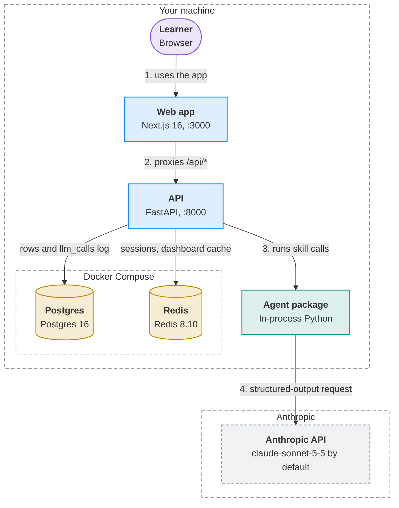
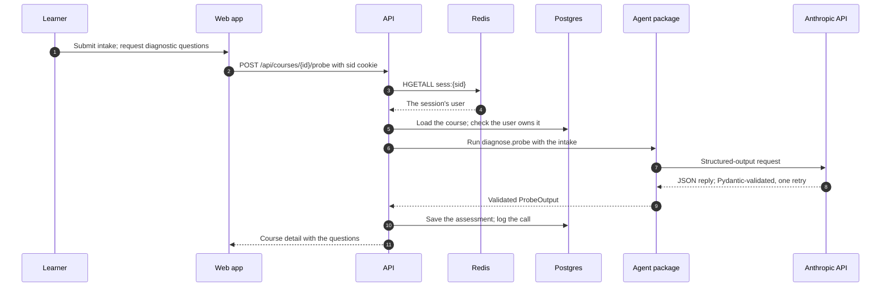

<!-- Generated by visualizer from architecture.json. Don't edit this file: edit the model, or rerun /visualizer:architecture. -->

# Instructor architecture

Instructor is an adaptive learning-course agent. A Next.js app proxies every /api call to a FastAPI backend, which runs product skills through an in-process agent package. The agent package is the only caller of the Anthropic API. Postgres is the source of truth; Redis holds sessions and caches that can always be rebuilt.

**Highlights**

- Postgres is the only source of truth; Redis holds nothing that can't be rebuilt.
- Every LLM call goes through one wrapper: Pydantic-validated output, one retry, every attempt logged to llm_calls.
- The browser only talks to Next.js, which proxies /api/* to FastAPI, so the session cookie stays same-origin.
- ANTHROPIC_API_KEY lives in .env and is read by the API process only; the browser never sees it.
- Both data stores bind to 127.0.0.1, so they are not exposed on the network.

## Overview

| Shape | Colour | Meaning |
|---|---|---|
| Rounded box | purple | Client: a person or app that uses the system |
| Box | blue | Service you run |
| Box | teal | Module inside a program |
| Cylinder | yellow | Datastore: where state lives |
| Dashed box | grey | External system you don't run |
| Dashed outline | — | Trust or deployment boundary |
| Solid arrow | — | Call or request |
| 1. 2. 3. before a label | — | The main path, in order |

## Components

| Component | Kind | Runs in | Responsibility | Evidence |
|---|---|---|---|---|
| **Learner** Browser | client | Your machine | Takes a course through the browser: intake, diagnostic, lessons and quizzes. | [`web/src/app/`](../../web/src/app/) |
| **Web app** Next.js 16, :3000 | service | Your machine | Renders the UI, redirects visitors without a session cookie, and proxies /api/* to FastAPI. | [`web/next.config.ts`](../../web/next.config.ts), [`web/src/proxy.ts`](../../web/src/proxy.ts), [`web/src/app/`](../../web/src/app/) |
| **API** FastAPI, :8000 | service | Your machine | Authenticates the user, enforces ownership, runs services and routes skill calls to the agent. | [`backend/app/main.py`](../../backend/app/main.py), [`backend/app/api/`](../../backend/app/api/), [`backend/app/auth.py`](../../backend/app/auth.py), [`backend/app/services/`](../../backend/app/services/) |
| **Agent package** In-process Python Includes: Skill registry, LLM client wrapper, diagnose skill | module | Your machine | Loads product skills and prompts, and makes every model call through one validated, logged client. | [`backend/agent/registry.py`](../../backend/agent/registry.py), [`backend/agent/llm.py`](../../backend/agent/llm.py), [`backend/agent/skills/`](../../backend/agent/skills/) |
| **Postgres** Postgres 16 | datastore | Your machine › Docker Compose | Source of truth for users, courses, enrollments, assessments, progress and the LLM call log. | [`docker-compose.yml`](../../docker-compose.yml), [`backend/app/models.py`](../../backend/app/models.py), [`backend/migrations/`](../../backend/migrations/), [`docs/data-model.md`](../data-model.md) |
| **Redis** Redis 8.10 | datastore | Your machine › Docker Compose | Holds login sessions and the dashboard cache; LLM response caches are planned for CP2/CP3. | [`docker-compose.yml`](../../docker-compose.yml), [`backend/app/auth.py`](../../backend/app/auth.py), [`backend/app/services/dashboard.py`](../../backend/app/services/dashboard.py), [`docs/data-model.md#6-redis-key-space`](../data-model.md#6-redis-key-space) |
| **Anthropic API** claude-sonnet-5-5 by default | external | Anthropic | Generates structured diagnostic, lesson and grading output for the skills. | [`backend/agent/llm.py`](../../backend/agent/llm.py), [`.env.example`](../../.env.example) |

## Where state lives

| Store | Runs in | Holds | Lifetime | Reached by |
|---|---|---|---|---|
| **Postgres** | Your machine › Docker Compose | Orgs, users, courses, enrollments, assessments, plans, progress | Durable | API |
| **Postgres** | Your machine › Docker Compose | llm_calls: one row per model request | Durable | API |
| **Redis** | Your machine › Docker Compose | Login sessions (sess:{token}, hash) | 8 h TTL, deleted on logout | API |
| **Redis** | Your machine › Docker Compose | Dashboard cache (dash:{user_id}, JSON) | 10 min TTL, deleted on writes | API |

## Flows

### Generate diagnostic questions

After a learner creates a course, the API asks the diagnose skill for probe questions and stores them.

## Notes

Kept exactly as written. They steer what the diagram includes.

> keep it simple for v1, focus on the core components; should look clean and professional
>
> Added 2026-10-11

---

Generated by visualizer from [`architecture.json`](architecture.json). Model as of commit `dd0d0ce` (2026-10-11). Content hash `bd886534ec3a`.
