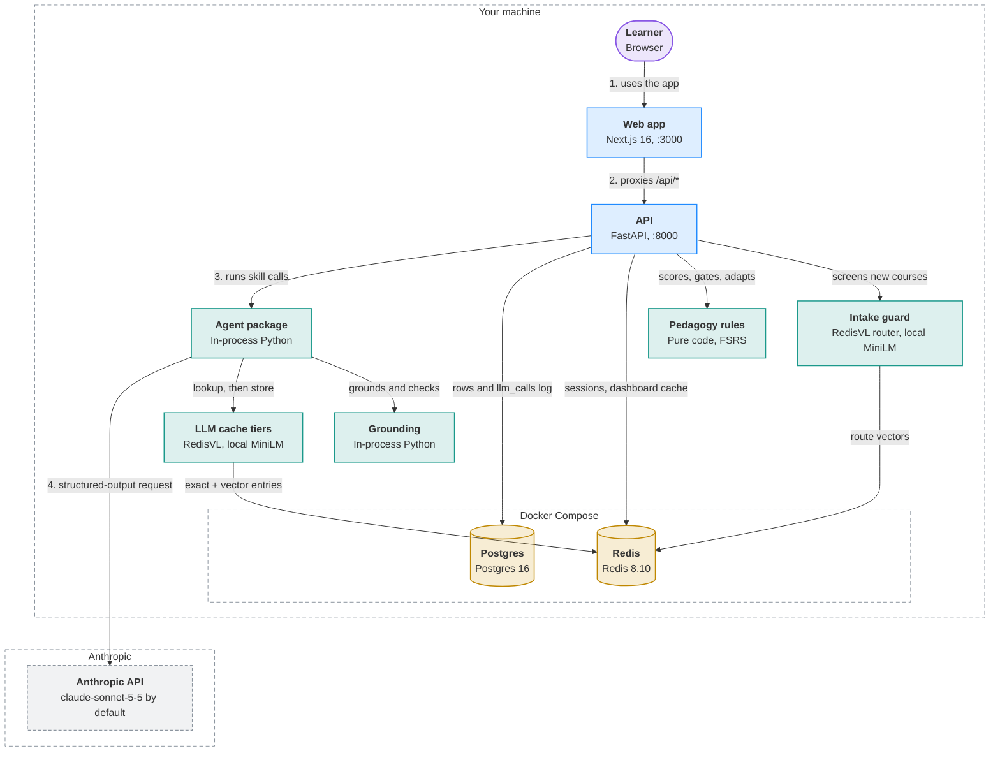
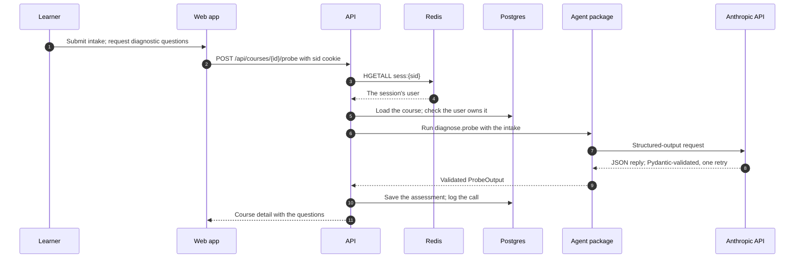
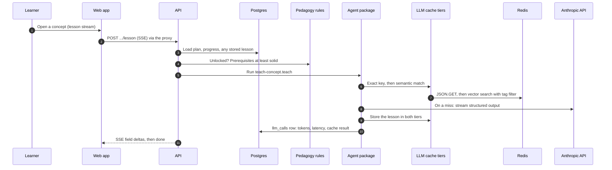
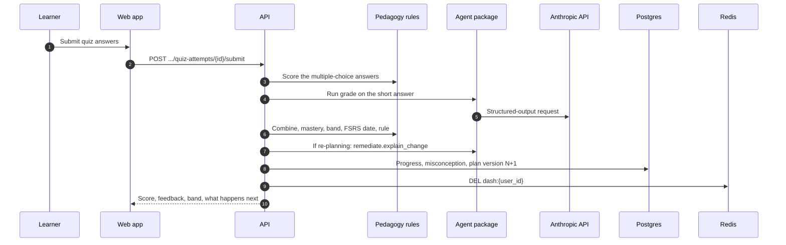

<!-- Generated by visualizer from architecture.json. Don't edit this file: edit the model, or rerun /visualizer:architecture. -->

# Instructor architecture

Instructor is an adaptive learning-course agent. A Next.js app proxies every /api call to a FastAPI backend, which runs surface-neutral services over an in-process agent package. Skills write the language; deterministic code decides scores, mastery, gating and re-planning. Every model call goes through one wrapper that checks two Redis cache tiers before the Anthropic API. Postgres is the source of truth; Redis holds sessions and caches that can always be rebuilt.

**Highlights**

- Postgres is the only source of truth; Redis holds nothing that can't be rebuilt.
- Skills do language; code does decisions: scoring, mastery, gating, adaptation and FSRS are pure functions in agent/pedagogy.py.
- Every LLM call goes through one wrapper: Pydantic-validated output, one retry, every attempt logged to llm_calls.
- diagnose, grade and remediate are never cached, and neither is any request that carries a learner's misconceptions.
- ANTHROPIC_API_KEY is read by the API process only, and both data stores bind to 127.0.0.1.

## Overview

| Shape | Colour | Meaning |
|---|---|---|
| Rounded box | purple | Client: a person or app that uses the system |
| Box | blue | Service you run |
| Box | teal | Module inside a program |
| Cylinder | yellow | Datastore: where state lives |
| Dashed box | grey | External system you don't run |
| Dashed outline | — | Trust or deployment boundary |
| Solid arrow | — | Call or request |
| 1. 2. 3. before a label | — | The main path, in order |

## Components

| Component | Kind | Runs in | Responsibility | Evidence |
|---|---|---|---|---|
| **Learner** Browser | client | Your machine | Takes a course through the browser: intake, diagnostic, lessons and quizzes; admins also manage org docs and courses. | [`web/src/app/`](../../web/src/app/) |
| **Web app** Next.js 16, :3000 | service | Your machine | Renders the UI, redirects visitors without a session cookie, and proxies /api/* to FastAPI. | [`web/next.config.ts`](../../web/next.config.ts), [`web/src/proxy.ts`](../../web/src/proxy.ts), [`web/src/app/`](../../web/src/app/) |
| **API** FastAPI, :8000 Includes: Routers (web surface), Services | service | Your machine | Authenticates the user, enforces ownership and the unlock gate, and runs the services that call the agent. | [`backend/app/main.py`](../../backend/app/main.py), [`backend/app/api/`](../../backend/app/api/), [`backend/app/auth.py`](../../backend/app/auth.py), [`backend/app/services/`](../../backend/app/services/) |
| **Agent package** In-process Python Includes: Skill registry, LLM client wrapper, Skills | module | Your machine | Loads product skills and prompts, and makes every model call through one validated, logged client. | [`backend/agent/registry.py`](../../backend/agent/registry.py), [`backend/agent/llm.py`](../../backend/agent/llm.py), [`backend/agent/skills/`](../../backend/agent/skills/) |
| **Pedagogy rules** Pure code, FSRS Includes: pedagogy, plan (DAG validation, diff) | module | Your machine | Decides scores, mastery, bands, the unlock gate, adaptation rules and review dates; no model involved. | [`backend/agent/pedagogy.py`](../../backend/agent/pedagogy.py), [`backend/agent/plan.py`](../../backend/agent/plan.py) |
| **LLM cache tiers** RedisVL, local MiniLM Includes: Exact tier, Semantic tier | module | Your machine | Serves a repeated or reworded request without a model call: exact key first, then a tag-filtered semantic match. | [`backend/agent/cache.py`](../../backend/agent/cache.py), [`backend/agent/semantic.py`](../../backend/agent/semantic.py), [`docs/architecture.md#four-uses-of-redis`](../architecture.md#four-uses-of-redis) |
| **Grounding** In-process Python | module | Your machine | Splits org docs into anchored sections and checks every citation's section and verbatim quote. | [`backend/agent/sources.py`](../../backend/agent/sources.py), [`backend/app/services/org_docs.py`](../../backend/app/services/org_docs.py), [`docs/architecture.md#org-courses-j3`](../architecture.md#org-courses-j3) |
| **Intake guard** RedisVL router, local MiniLM | module | Your machine | Rejects crude, off-topic, dangerous and prompt-injection course requests before anything is stored or sent. | [`backend/agent/guard.py`](../../backend/agent/guard.py), [`backend/app/api/courses.py`](../../backend/app/api/courses.py) |
| **Postgres** Postgres 16 | datastore | Your machine › Docker Compose | Source of truth for users, orgs, docs, courses, plans, progress, lessons, quizzes and the LLM call log. | [`docker-compose.yml`](../../docker-compose.yml), [`backend/app/models.py`](../../backend/app/models.py), [`backend/migrations/`](../../backend/migrations/), [`docs/data-model.md`](../data-model.md) |
| **Redis** Redis 8.10 | datastore | Your machine › Docker Compose | Holds sessions, the dashboard cache and both LLM cache tiers; everything in it can be rebuilt. | [`docker-compose.yml`](../../docker-compose.yml), [`backend/app/auth.py`](../../backend/app/auth.py), [`backend/app/services/dashboard.py`](../../backend/app/services/dashboard.py), [`backend/agent/cache.py`](../../backend/agent/cache.py), [`backend/agent/semantic.py`](../../backend/agent/semantic.py), [`backend/agent/guard.py`](../../backend/agent/guard.py), [`docs/data-model.md#6-redis-key-space`](../data-model.md#6-redis-key-space) |
| **Anthropic API** claude-sonnet-5-5 by default | external | Anthropic | Generates structured probe, map, lesson, quiz, grading and re-plan output for the skills. | [`backend/agent/llm.py`](../../backend/agent/llm.py), [`.env.example`](../../.env.example) |

## Where state lives

| Store | Runs in | Holds | Lifetime | Reached by |
|---|---|---|---|---|
| **Postgres** | Your machine › Docker Compose | Orgs, users, courses, enrollments, plan versions, progress, lessons, quiz attempts, misconceptions | Durable | API |
| **Postgres** | Your machine › Docker Compose | Org docs: immutable, sectioned, hashed | Durable | API |
| **Postgres** | Your machine › Docker Compose | llm_calls: one row per model attempt | Durable | API |
| **Redis** | Your machine › Docker Compose | Login sessions (sess:{token}, hash) | 8 h TTL, deleted on logout | API, LLM cache tiers, Intake guard |
| **Redis** | Your machine › Docker Compose | Dashboard cache (dash:{user_id}, JSON) | 10 min TTL, deleted on writes | API, LLM cache tiers, Intake guard |
| **Redis** | Your machine › Docker Compose | Exact LLM cache (llm:exact:{sha256}, JSON) | 7 day TTL | API, LLM cache tiers, Intake guard |
| **Redis** | Your machine › Docker Compose | Semantic LLM cache (idx:llm_semantic, vector index) | 7 day TTL per entry | API, LLM cache tiers, Intake guard |
| **Redis** | Your machine › Docker Compose | Intake guard routes (idx:intake_guard, vector index) | Rebuilt at startup | API, LLM cache tiers, Intake guard |

## Flows

### Generate diagnostic questions

After a learner creates a course, the API asks the diagnose skill for probe questions and stores them. Diagnose is never cached.

### Open a concept's lesson

The unlock gate runs first. A stored lesson opens instantly; otherwise the lesson is served from the exact or semantic cache, or generated and streamed.

### Grade a quiz and adapt the plan

Grading is never cached. Code scores, sets mastery and the review date, and decides whether the plan changes; a skill only writes the words.

## Notes

Kept exactly as written. They steer what the diagram includes.

> keep it simple for v1, focus on the core components; should look clean and professional
>
> Added 2026-10-11

> output to docs/architecture; keep consistent with docs/architecture.md (the hand-written doc); regenerate from the current code. README keeps its hand-written diagram and embeds this overview collapsed beneath it.
>
> Added 2026-10-12

---

Generated by visualizer from [`architecture.json`](architecture.json). Model as of commit `104e5af` (2026-10-12). Content hash `55e7c84f4e4e`.
