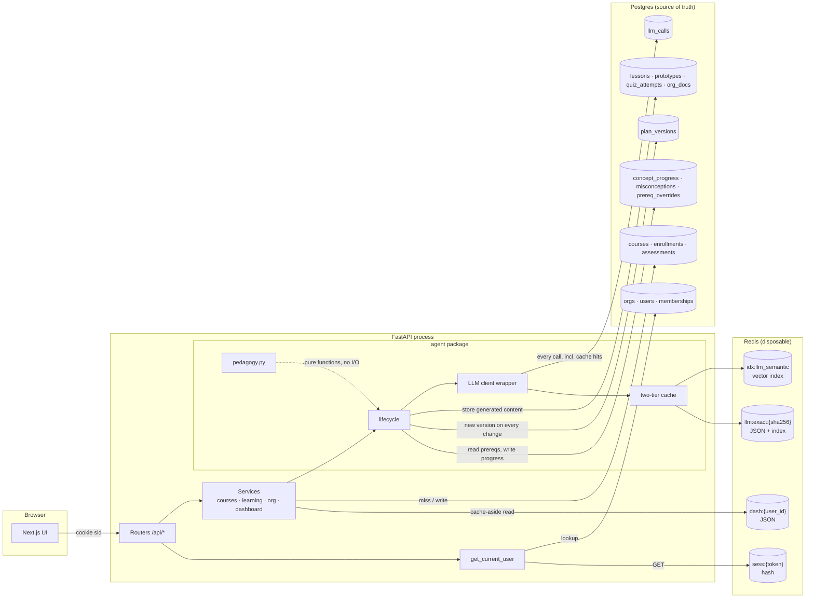
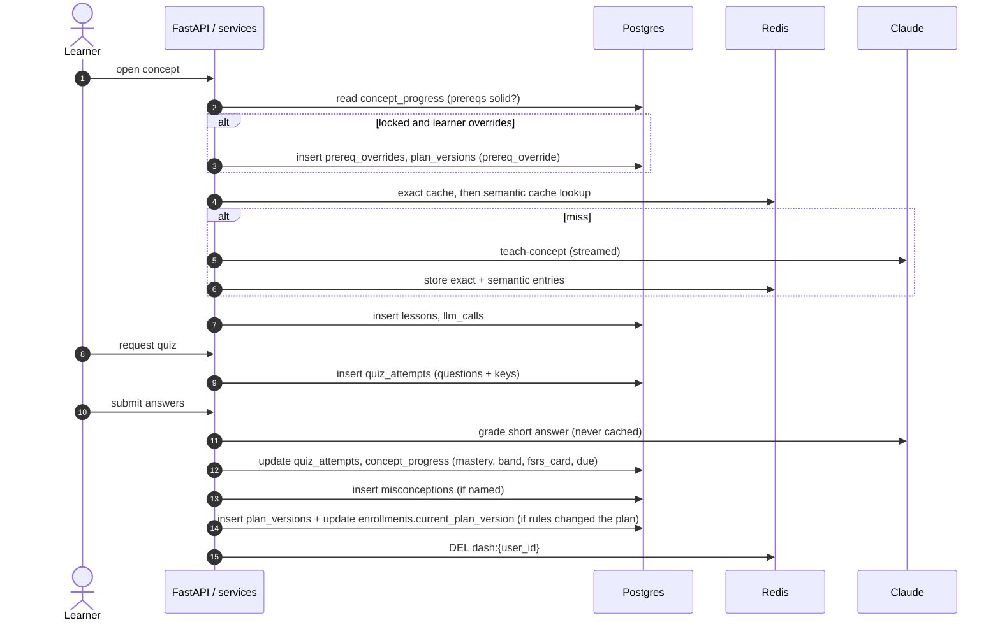
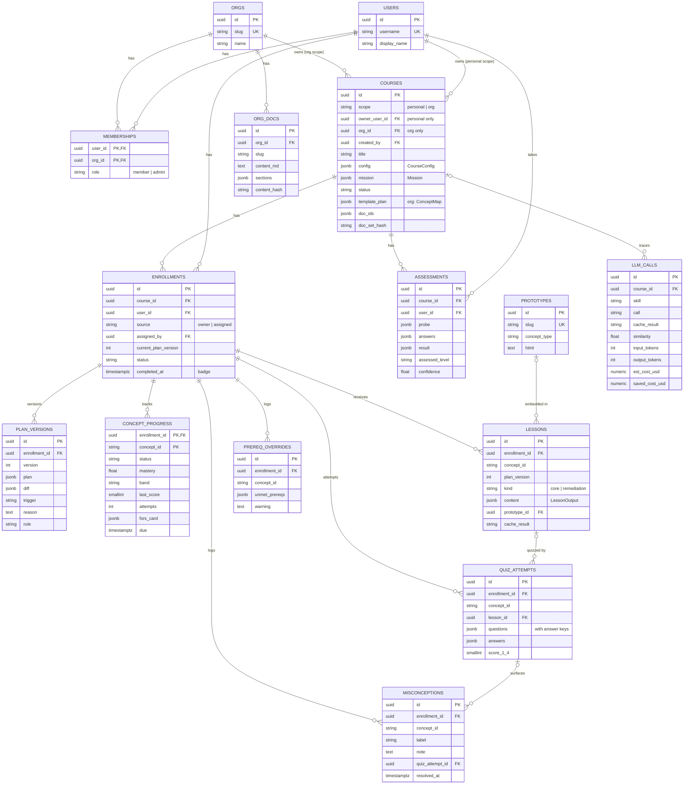

# Data model

Instructor stores every piece of data it uses in one of three places. This doc covers:
- where each model lives
- what its fields mean
- when and how it's written, updated and read
- an example of each with sample data

**Source of truth for the code:** `backend/app/models.py` for the Postgres tables, and the Pydantic schemas in `backend/agent/skills/*/schema.py` for the JSONB document shapes. If this doc and the code disagree, the code wins and this doc needs fixing.

**Status legend:**
- ✅ = the schema exists (PC0.4)
- 🔜 PCx.y = the pair checkpoint where the app starts writing or reading it
- ✔︎ PCx.y = live since that pair checkpoint

---

## 1. Where data lives

| Store | Role | Durability | What's in it |
|---|---|---|---|
| **Postgres 16** | Source of truth | Durable (Docker volume `pgdata`; Alembic-migrated) | Identity, courses, enrollments, plans, learner progress, lessons, quizzes, org docs, the LLM call log |
| **JSONB columns** (inside Postgres) | Documents whose shape is still evolving | Durable (same as Postgres) | Course config, mission, concept maps, quiz questions, FSRS cards. Each is validated by a Pydantic model at the service boundary |
| **Redis 8** | Speed and cost layer | Disposable: everything can be rebuilt from Postgres or regenerated | Sessions, the dashboard cache, the exact-match LLM cache, the semantic LLM cache (vector index) |
| **Browser** | Session handle and display preference | Per browser; clearing site data loses only the theme choice | The `sid` cookie (§6.1) and `localStorage["instructor-theme"]` (`"light"` or `"dark"`, written only when the learner uses the theme toggle; absent means follow the OS setting). No learning data is stored in the browser |

**Design rules:**
1. **Postgres is the only source of truth.** Losing Redis costs a re-login and a cold cache, never data.
2. **The course is shared; the learning path is personal.** Per-learner state hangs off an **enrollment** (course × user), never off the course (ADR-0004).
3. **Rigid where integrity matters, flexible where the product is evolving.** Foreign keys, uniques and the course scope check enforce integrity. JSONB plus Pydantic holds the shapes that are still changing (ADR-0010).
4. **Enums are `StrEnum`s stored as `VARCHAR(32)`.** The app validates them; the database doesn't (ADR-0010).
5. **Answer keys never leave the server.** Quiz questions are stored with their keys, and the API strips the keys before responding.

---

## 2. Data in the application architecture



### Who writes what during the learning loop (J2)



---

## 3. Entity relationships (Postgres)



`concept_id` is a string slug from the concept map (e.g. `liveness-vs-readiness`), not a foreign key. Concepts live inside the plan's JSONB, so progress rows reference them by id.

---

## 4. Postgres tables

Conventions that apply to every table:

| Convention | Detail |
|---|---|
| Primary keys | `uuid` generated by the app (`uuid4`), except where noted |
| Timestamps | `timestamptz`; `created_at` defaults to `now()` on the server |
| Foreign keys | `ON DELETE CASCADE`: deleting an enrollment removes its plans, progress, lessons and attempts |
| Constraint names | Deterministic (`uq_…`, `fk_…`, `ck_…`, `ix_…`), so migrations diff cleanly |
| Schema changes | Edit `app/models.py` → `make migration m="…"` → review → `make migrate`. CI runs `alembic check` |

### 4.1 Identity

#### `orgs` ✅
An organization whose courses can be grounded in its own docs and assigned to its members.

| Field | Type | Null | Notes |
|---|---|---|---|
| `id` | uuid | no | PK |
| `name` | varchar(200) | no | Display name |
| `slug` | varchar(64) | no | Unique; stable handle used by seeds and URLs |
| `created_at` | timestamptz | no | |

| Operation | When | How |
|---|---|---|
| Write | Seed (`make seed`) | Upsert on `slug` |
| Read | Org admin pages, grounding, semantic-cache bucket (`org_id`) | By id or slug |

```json
{ "id": "8f1c…a001", "name": "Acme AI", "slug": "acme", "created_at": "2026-10-11T07:00:00Z" }
```

#### `users` ✅
A person who can log in. Phase 1 has seeded users only; Google sign-in is planned for P2.

| Field | Type | Null | Notes |
|---|---|---|---|
| `id` | uuid | no | PK |
| `username` | varchar(64) | no | Unique; the login picker shows these |
| `display_name` | varchar(200) | no | |
| `created_at` | timestamptz | no | |

| Operation | When | How |
|---|---|---|
| Write | Seed | Upsert on `username` |
| Read | Login (🔜 PC0.5), `get_current_user` on every request (resolved from the session) | By id or username |

```json
{ "id": "2b7e…b002", "username": "dana", "display_name": "Dana (new backend engineer at Acme AI)" }
```

#### `memberships` ✅
Links a user to an org, with a role. The PK is `(user_id, org_id)`.

| Field | Type | Null | Notes |
|---|---|---|---|
| `user_id` | uuid | no | PK, FK → users |
| `org_id` | uuid | no | PK, FK → orgs |
| `role` | varchar(32) | no | `member` \| `admin` |

| Operation | When | How |
|---|---|---|
| Write | Seed | Upsert on `(user_id, org_id)` |
| Read | Authorization: only admins create, ground and assign org courses (🔜 CP4); dashboard org labels | Join on user |

| user | org | role |
|---|---|---|
| dana | acme | member |
| priya | acme | admin |

### 4.2 Courses and enrollments

#### `courses` ✅
The **shared definition** of a course: what it's about and how it's configured. It holds no per-learner progress.

| Field | Type | Null | Notes |
|---|---|---|---|
| `id` | uuid | no | PK |
| `scope` | varchar(32) | no | `personal` \| `org` |
| `owner_user_id` | uuid | yes | FK → users; set **only** for personal courses |
| `org_id` | uuid | yes | FK → orgs; set **only** for org courses |
| `created_by` | uuid | no | FK → users (for org courses, the admin) |
| `title` | varchar(300) | no | |
| `config` | jsonb | no | `CourseConfig` (§5.1): the intake knobs |
| `mission` | jsonb | no | `Mission` (§5.1): goal, what "expert" means, mode, analogy domain |
| `status` | varchar(32) | no | `draft` → `probed` → `assessed` → `mapped` → `active` |
| `template_plan` | jsonb | yes | The course's base `ConceptMap` (ADR-0016): proposed while `mapped`, final once accepted; each enrollment copies it into plan v1. For org courses, the admin-accepted map |
| `doc_ids` | jsonb | no | Org doc ids used for grounding (default `[]`) |
| `doc_set_hash` | varchar(64) | yes | Hash of the grounding doc set; part of the semantic cache bucket |
| `created_at`, `updated_at` | timestamptz | no | `updated_at` is set on every update |

**Integrity:** `ck_courses_scope_owner` requires a personal course to have an owner and no org, and an org course to have an org and no owner.

| Operation | When | How |
|---|---|---|
| Write | Intake form submitted (✔︎ PC1.1, `POST /api/courses`) | Insert with `status=draft`, `scope=personal`, owner = the learner |
| Update | After probe (✔︎ PC1.1: `draft` → `probed`), assessment (✔︎ PC1.2: → `assessed`), map (✔︎ PC1.3: → `mapped`, once only), and accept (✔︎ PC1.4: → `active`) | `status` advances; `template_plan` is set by `map-concepts` (validated `ConceptMap`) and edited before accept (✔︎ PC1.4, `DELETE /api/courses/{id}/map/concepts/{concept_id}`: dependents are rewired, ADR-0017); read-only once `active` |
| Read | Dashboard, course page, every generation call (config and mission shape the prompts) | By id; list by owner or org |

```json
{
  "id": "c0de…c001", "scope": "org", "owner_user_id": null, "org_id": "8f1c…a001",
  "created_by": "5a9d…b003", "title": "Technical readiness at Acme AI",
  "config": { "topic": "On-call readiness", "target_hours": 3, "target_level": "intermediate",
              "self_level": "intermediate", "formats": ["reading", "quizzes", "hands_on"] },
  "mission": { "goal": "Handle a first on-call shift alone", "expert_means": "Can triage a checkout 5xx spike",
               "mode": "foundation", "deadline": null, "analogy_domain": "restaurants" },
  "status": "active", "template_plan": { "…": "ConceptMap (§5.2)" },
  "doc_ids": ["d0c5…0001", "d0c5…0003"], "doc_set_hash": "3f9a…e2"
}
```

#### `enrollments` ✅
**One learner's journey through one course.** Plans, progress, lessons, quizzes and misconceptions all belong to this row, so one learner's adaptations never leak to another learner in the same org course. It replaces a separate assignments table: an assignment is an enrollment with `source=assigned`.

| Field | Type | Null | Notes |
|---|---|---|---|
| `id` | uuid | no | PK |
| `course_id` | uuid | no | FK → courses |
| `user_id` | uuid | no | FK → users; **unique together with `course_id`** |
| `source` | varchar(32) | no | `owner` (created it) \| `assigned` (an admin assigned it) |
| `assigned_by` | uuid | yes | FK → users (the admin) |
| `current_plan_version` | int | no | Points at the latest `plan_versions.version` (default 0) |
| `status` | varchar(32) | no | `active` \| `complete` |
| `completed_at` | timestamptz | yes | Set when every concept is solid or better; this **is** the badge |
| `created_at` | timestamptz | no | |

| Operation | When | How |
|---|---|---|
| Write | Personal course accepted (✔︎ PC1.4, `POST /api/courses/{id}/accept`); admin assigns an org course (🔜 PC4.3) | Insert (`source=owner`, `current_plan_version=1`), then plan v1 and `concept_progress`, in **one transaction**; then `invalidate_dashboard` |
| Update | Every plan change (`current_plan_version`); course completion (`status`, `completed_at`) | Same transaction as the `plan_versions` insert |
| Read | Dashboard (active and complete, badges), every learning-loop request | By id; list by user |

```json
{ "id": "e001…0001", "course_id": "c0de…c001", "user_id": "2b7e…b002", "source": "assigned",
  "assigned_by": "5a9d…b003", "current_plan_version": 2, "status": "active", "completed_at": null }
```

#### `assessments` ✅
The diagnostic probe (3–4 questions at the claimed level), the learner's answers, and the assessed result (spec §4.2–4.3).

| Field | Type | Null | Notes |
|---|---|---|---|
| `id` | uuid | no | PK |
| `course_id` | uuid | no | FK → courses |
| `user_id` | uuid | no | FK → users |
| `probe` | jsonb | no | `ProbeOutput` (§5.3) |
| `answers` | jsonb | yes | `{question_id: free-text answer}`, one key per probe question (trimmed; blank = "I don't know"). The model receives them as an ordered list (`AssessInput.answers`) |
| `result` | jsonb | yes | `AssessOutput` (§5.3) |
| `assessed_level` | varchar(32) | yes | Copied from the result for easy querying |
| `confidence` | float | yes | 0–1 |
| `created_at` | timestamptz | no | |

| Operation | When | How |
|---|---|---|
| Write | Probe generated (✔︎ PC1.1, `POST /api/courses/{id}/probe`) | Insert with `probe`. Idempotent: if one exists for `(course_id, user_id)` it's returned and no LLM call is made. The API never returns `targets_concept` to the learner (it would be a hint) |
| Update | Answers submitted and assessed (✔︎ PC1.2, `POST /api/courses/{id}/assess`) | Set `answers`, `result`, `assessed_level`, `confidence`; course `probed` → `assessed`. **Once only** (ADR-0014): a resubmit returns the stored result, and answers must cover exactly the probe's question ids (else 422) |
| Read | Concept map generation (assessment shapes the map); course page shows the level adjustment | Latest by `(course_id, user_id)` |

```json
{
  "probe": { "questions": [{ "id": "q1", "prompt": "A pod passes liveness but fails readiness. What happens to its traffic?",
                              "targets_concept": "probes", "level": "intermediate" }] },
  "answers": { "q1": "Kubernetes restarts it." },
  "result": { "claimed_level": "intermediate", "assessed_level": "novice", "confidence": 0.7,
              "evidence": [{ "question_id": "q1", "observation": "Confuses readiness with liveness", "points_to": "novice" }],
              "gaps": ["probe semantics"],
              "adjustment_message": "You said intermediate, but your answer on q1 suggests we start a step earlier: readiness failures remove a pod from the Service; they don't restart it." },
  "assessed_level": "novice", "confidence": 0.7
}
```

#### `plan_versions` ✅
**Every change to a learner's plan is a new, immutable version** with a trigger, a plain-English reason and a diff (spec §4.8). The plan diff UI reads from this table. Unique on `(enrollment_id, version)`.

| Field | Type | Null | Notes |
|---|---|---|---|
| `id` | uuid | no | PK |
| `enrollment_id` | uuid | no | FK → enrollments |
| `version` | int | no | 1, 2, 3, … |
| `plan` | jsonb | no | The full `ConceptMap` at this version (§5.2) |
| `diff` | jsonb | yes | `PlanDiff` against the previous version (§5.2); null for v1 |
| `trigger` | varchar(32) | no | `diagnosis` \| `assignment` \| `quiz_result` \| `prereq_override` \| `user_request` (P2 chat) |
| `reason` | text | no | v1: the map's `sequence_rationale`. Later versions: written by `remediate.explain_change`, naming the score and the misconception |
| `rule` | varchar(64) | yes | Which `pedagogy.adapt` rule fired, e.g. `insert_remediation` |
| `created_at` | timestamptz | no | |

| Operation | When | How |
|---|---|---|
| Write | Accept (✔︎ PC1.4: v1, `diagnosis`, the accepted map); org assignment (v1, `assignment`); ✔︎ PC2.5–2.6: an inserted remediation (`quiz_result`, rule `insert_remediation`, reason from `remediate.explain_change`), an accepted test-out (`quiz_result`, `offer_test_out`), an override (`prereq_override`). Only structural changes are versions; unlocks are progress (ADR-0022); P2 chat (`user_request`) | Insert-only, in the same transaction as the `enrollments.current_plan_version` update |
| Update | Never | Versions are immutable |
| Read | Learning loop (current version); plan history and diff UI (✔︎ PC2.5, `GET …/plans`, newest first) | Latest version, or a specific one |

```json
{ "version": 2, "trigger": "quiz_result", "rule": "insert_remediation",
  "reason": "You scored 2 on 'Liveness vs readiness'. You believe a liveness failure removes the pod from the load balancer; it restarts the container instead. Added a short concept that attacks that from a different angle.",
  "diff": { "added": [{ "id": "liveness-vs-readiness-remedy-1", "title": "What actually happens when a probe fails", "remedy": { "for_concept": "liveness-vs-readiness", "angle": "…", "misconception": { "label": "…", "note": "…" } } }],
            "removed": [], "prereq_changes": [{ "concept_id": "liveness-vs-readiness", "added": ["liveness-vs-readiness-remedy-1"], "removed": [] }],
            "status_changes": [{ "concept_id": "liveness-vs-readiness-remedy-1", "old": "locked", "new": "unlocked" },
                               { "concept_id": "liveness-vs-readiness", "old": "in_progress", "new": "locked" }],
            "test_out": [] } }
```

### 4.3 Learner model

#### `concept_progress` ✅
**The learner model**: one row per enrollment per concept (spec §3). The PK is `(enrollment_id, concept_id)`. Indexed on `due` for the "N concepts due for review" count.

| Field | Type | Null | Notes |
|---|---|---|---|
| `enrollment_id` | uuid | no | PK, FK → enrollments |
| `concept_id` | varchar(100) | no | PK; concept slug from the plan |
| `status` | varchar(32) | no | `locked` \| `unlocked` \| `in_progress` \| `complete` |
| `mastery` | float | yes | 0–1. The first attempt equals the evidence; later attempts use 0.3 × previous + 0.7 × evidence (spec §4.9, ADR-0005) |
| `band` | varchar(32) | yes | `shaky` < 0.4 ≤ `learning` < 0.7 ≤ `solid` < 0.9 ≤ `mastered` |
| `last_score` | smallint | yes | 1–4 (combined: the lower of the multiple-choice and short-answer scores) |
| `attempts` | int | no | Graded attempts so far |
| `last_attempt_at` | timestamptz | yes | |
| `fsrs_card` | jsonb | yes | Serialized `fsrs.Card` (§5.5); null until the first graded attempt |
| `due` | timestamptz | yes | Next review date, from FSRS |

| Operation | When | How |
|---|---|---|
| Write | Plan accepted (✔︎ PC1.4) or assigned (🔜 PC4.3): one row per concept (`locked`, or `unlocked` if it has no prereqs: `pedagogy.initially_unlocked`) | Bulk insert, same transaction as the enrollment |
| Update | Quiz graded (✔︎ PC2.4–2.5): `mastery`, `band`, `last_score`, `attempts`, `fsrs_card`, `due`; `complete` at solid or better; the gate is recomputed (locked → unlocked when every prereq is solid; an open concept re-locks when a remediation is inserted before it, unless overridden). Override (✔︎ PC2.6): locked → unlocked. A remediation concept gets its own row when inserted | Values computed by the pure functions in `pedagogy.py`; the service writes them (`app/services/quiz.py`) |
| Read | Unlock gate before opening a concept; dashboard mastery bands and due count; quiz distractor targeting | By enrollment; `due <= now()` for the review count |

| concept_id | status | mastery | band | last_score | attempts | due |
|---|---|---|---|---|---|---|
| `incident-roles` | complete | 0.80 | solid | 3 | 1 | 2026-10-14 |
| `liveness-vs-readiness` | locked | 0.50 | learning | 2 | 1 | 2026-10-12 |
| `liveness-vs-readiness-remedy-1` | unlocked | null | null | null | 0 | null |

#### `misconceptions` ✅
A specific wrong belief named by the grader and logged for later quizzes, which target it with distractors (spec §4.6–4.7).

| Field | Type | Null | Notes |
|---|---|---|---|
| `id` | uuid | no | PK |
| `enrollment_id` | uuid | no | FK → enrollments |
| `concept_id` | varchar(100) | no | |
| `label` | varchar(300) | no | Short name |
| `note` | text | no | The underlying belief, in plain English |
| `source_question` | text | yes | The question that exposed it |
| `quiz_attempt_id` | uuid | yes | FK → quiz_attempts |
| `created_at` | timestamptz | no | |
| `resolved_at` | timestamptz | yes | Resolution tracking is P2 |

| Operation | When | How |
|---|---|---|
| Write | Quiz submitted (✔︎ PC2.4): one row per distinct belief shown, from each picked distractor's tag (deterministic) and from `grade` (the short answer; listed first) | Insert, deduplicated by label within the attempt |
| Update | P2: set `resolved_at` when later attempts on it come back clean | |
| Read | `design-assessment` (distractors), `teach-concept` for remediation, `remediate` (the "why") | Open ones (`resolved_at IS NULL`) by enrollment and concept. **Any request that includes these bypasses the cache** (ADR-0007) |

```json
{ "concept_id": "liveness-vs-readiness", "label": "liveness failure = removed from load balancer",
  "note": "Believes a failed liveness probe takes the pod out of Service endpoints; it actually restarts the container.",
  "source_question": "A pod's liveness probe starts failing during a deploy. What happens first?" }
```

#### `prereq_overrides` ✅
A logged choice to open a locked concept after seeing a specific warning (spec §4.8: "they're adults; they should know the cost").

| Field | Type | Null | Notes |
|---|---|---|---|
| `id` | uuid | no | PK |
| `enrollment_id` | uuid | no | FK → enrollments |
| `concept_id` | varchar(100) | no | The locked concept that was opened |
| `unmet_prereqs` | jsonb | no | Concept ids that weren't yet solid |
| `warning` | text | no | What the learner was shown and confirmed (from `remediate.prereq_warning`, echoed back by the client on confirm) |
| `created_at` | timestamptz | no | |

| Operation | When | How |
|---|---|---|
| Write | Learner confirms an override (✔︎ PC2.6: `GET …/override` shows the warning, `POST …/override` confirms) | Insert, plus a new `plan_versions` row (`prereq_override`) |
| Read | Plan history; P2 analytics (do overrides predict low scores?) | By enrollment |

```json
{ "concept_id": "triage-5xx-spike", "unmet_prereqs": ["liveness-vs-readiness"],
  "warning": "Without probe semantics you'll misread pods restarting during the spike as the cause rather than a symptom." }
```

### 4.4 Content

#### `prototypes` ✅
Self-contained HTML/JS simulators. They **only** render in a sandboxed iframe (`srcdoc`, `sandbox="allow-scripts"`, no same-origin).

| Field | Type | Null | Notes |
|---|---|---|---|
| `id` | uuid | no | PK |
| `slug` | varchar(100) | no | Unique |
| `concept_type` | varchar(32) | no | `algorithm` \| `systems` \| `math` \| `syntax` \| `api` \| `conceptual` |
| `title` | varchar(300) | no | |
| `html` | text | no | The full document |
| `created_at` | timestamptz | no | |

| Operation | When | How |
|---|---|---|
| Write | Seeded by `make seed` from `backend/seed/prototypes/<slug>.html` (✔︎ PC2.3); live generation via `build-prototype` (P1+) | Upsert on `slug` |
| Read | A lesson for a hands-on learner whose concept matches (`app/services/prototypes.py`: a rule on the concept's own words) stores `lessons.prototype_id`; the lesson view returns the HTML | By id |

```json
{ "slug": "conn-pool-sim", "concept_type": "systems", "title": "Connection-pool exhaustion simulator",
  "html": "<!doctype html><html>… sliders: request rate, pool size, query latency …</html>" }
```

#### `lessons` ✅
Generated lesson content for one concept in one enrollment, stored **surface-neutral** (markdown, Mermaid and citations) so any surface (web, MCP) can render it.

| Field | Type | Null | Notes |
|---|---|---|---|
| `id` | uuid | no | PK |
| `enrollment_id` | uuid | no | FK → enrollments |
| `concept_id` | varchar(100) | no | |
| `plan_version` | int | no | The plan version it was generated under |
| `kind` | varchar(32) | no | `core` \| `remediation` |
| `content` | jsonb | no | `LessonOutput` (§5.4) |
| `prototype_id` | uuid | yes | FK → prototypes; set at generation for hands-on learners when the concept matches a seeded prototype |
| `cache_result` | varchar(32) | no | `miss` \| `exact_hit` \| `semantic_hit` \| `bypass` |
| `cache_key` | varchar(128) | yes | The exact-tier key (`llm:exact:…`, set on a miss too), or the semantic entry id it came from (CP3) |
| `created_at` | timestamptz | no | |

| Operation | When | How |
|---|---|---|
| Write | Concept opened for the first time, after the stream completes (✔︎ PC2.2, `POST /api/enrollments/{id}/concepts/{cid}/lesson`). Also moves `concept_progress.status` unlocked → in_progress and invalidates the dashboard. Remediation concepts (✔︎ PC2.5) get `kind = remediation`, written by `remediate.lesson` (never cached) | Insert the validated `LessonOutput`; if two tabs raced, the first stored lesson wins. A stream the client abandons is not stored (or cached) |
| Read | Reopening a concept (no regeneration); `design-assessment` input; walkthrough and history | Latest by `(enrollment_id, concept_id)` |

```json
{ "concept_id": "liveness-vs-readiness", "kind": "core", "cache_result": "semantic_hit",
  "content": { "explanation_md": "Counterintuitive part first: a failing **readiness** probe never restarts anything…",
               "example_md": "During Acme AI's inference-gateway deploy…",
               "diagram_mermaid": "flowchart LR\n  P[Pod] -->|readiness fails| S[Removed from Service]\n  P -->|liveness fails| R[Container restarted]",
               "citations": [{ "doc": "on-call-runbook", "section": "health-checks" }], "not_in_docs": [] } }
```

#### `quiz_attempts` ✅
One quiz round for a concept: the questions **with answer keys**, which stay on the server, plus the learner's answers and the grading.

| Field | Type | Null | Notes |
|---|---|---|---|
| `id` | uuid | no | PK |
| `enrollment_id` | uuid | no | FK → enrollments |
| `concept_id` | varchar(100) | no | |
| `lesson_id` | uuid | yes | FK → lessons (the quiz was designed from this lesson) |
| `questions` | jsonb | no | `QuizOutput` (§5.4), including answers and rubrics |
| `answers` | jsonb | yes | `{question_id: option_id or free text}`; first try only |
| `mcq_correct` | smallint | yes | Multiple-choice questions answered correctly (0–4) |
| `mcq_score` | smallint | yes | Mapped 1–4 (4/4 → 4, 3/4 → 3, 2/4 → 2, 0–1 → 1) |
| `short_score` | smallint | yes | 1–4 from the LLM grader; a 4 requires transfer |
| `score_1_4` | smallint | yes | **Combined: the lower of the two** |
| `feedback` | jsonb | yes | The whole graded result (`QuizResult` in `app/services/quiz.py`): per-question results with the revealed key and the picked distractor's belief, the grader's feedback, mastery, band, due, the rule, the "why", the diff and any test-out offer. `GET …/quiz-attempts/{id}` returns it without re-grading |
| `misconceptions_named` | jsonb | yes | Labels logged to `misconceptions` |
| `created_at` | timestamptz | no | |
| `submitted_at` | timestamptz | yes | Null until submitted |

| Operation | When | How |
|---|---|---|
| Write | Learner requests the quiz (✔︎ PC2.4, `POST …/concepts/{cid}/quiz`, get-or-create: an unsubmitted attempt is returned again; the lesson page prefetches it) | Insert with `questions`; the API response strips answer keys, distractor tags and the rubric |
| Update | Answers submitted (✔︎ PC2.4, `POST …/quiz-attempts/{id}/submit`) | Row-locked (`FOR UPDATE`) so a double submit grades once; set `answers`, scores, `feedback`, `submitted_at`; update `concept_progress` in the same transaction |
| Read | Results page; grader calibration and evals (CP5) | By id |

```json
{ "mcq_correct": 2, "mcq_score": 2, "short_score": 2, "score_1_4": 2,
  "answers": { "q1": "b", "q2": "a", "q3": "d", "q4": "a", "explain": "Liveness takes it out of rotation." },
  "misconceptions_named": ["liveness failure = removed from load balancer"] }
```

#### `org_docs` ✅
An org's internal docs, used for grounding. Phase 1 puts them directly into the prompt (context stuffing); RAG with Redis vectors is the P2 upgrade. Unique on `(org_id, slug)`.

| Field | Type | Null | Notes |
|---|---|---|---|
| `id` | uuid | no | PK |
| `org_id` | uuid | no | FK → orgs |
| `title` | varchar(300) | no | |
| `slug` | varchar(100) | no | Citation key, e.g. `on-call-runbook` |
| `content_md` | text | no | Full markdown |
| `sections` | jsonb | no | `[{anchor, heading}]`, parsed from headings; citations must point at these |
| `content_hash` | varchar(64) | no | Feeds `courses.doc_set_hash` |
| `created_at` | timestamptz | no | |

| Operation | When | How |
|---|---|---|
| Write | Seed (the 4 Acme AI docs) or admin upload (🔜 PC4.1) | Insert; sections and hash computed on write |
| Read | Grounded generation (the `ground-in-sources` skill composes them into prompts); citation checks in evals | By `course.doc_ids` |

```json
{ "slug": "postmortem-pool-exhaustion", "title": "Postmortem: model-router connection-pool exhaustion",
  "sections": [{ "anchor": "timeline", "heading": "Timeline" }, { "anchor": "root-cause", "heading": "Root cause" }],
  "content_hash": "9c1e…44" }
```

### 4.5 Observability

#### `llm_calls` ✅
**Every model call is logged, including cache hits** (with zero tokens and cost), so the trace shows what was avoided. Indexed on `course_id` and `created_at`.

| Field | Type | Null | Notes |
|---|---|---|---|
| `id` | uuid | no | PK |
| `course_id` / `enrollment_id` / `user_id` | uuid | yes | Context (FKs) |
| `skill`, `call` | varchar(64) | no | e.g. `teach-concept` / `teach` |
| `model` | varchar(64) | no | The model that **served** the request, e.g. `claude-sonnet-5-5`; differs from the configured model after a refusal fallback (ADR-0013) |
| `prompt_version` | varchar(128) | no | `name@semver+sha8`; changes whenever the prompt files change |
| `cache_result` | varchar(32) | no | `miss` \| `exact_hit` \| `semantic_hit` \| `bypass` |
| `similarity` | float | yes | Semantic hits only |
| `cache_key` | varchar(128) | yes | |
| `input_tokens`, `output_tokens` | int | no | 0 on a hit |
| `latency_ms` | int | no | |
| `est_cost_usd` | numeric(10,6) | no | 0 on a hit |
| `saved_cost_usd`, `saved_latency_ms` | numeric / int | no | On a hit: the original generation's cost and latency, so savings are measured, not estimated |
| `status` | varchar(32) | no | `ok` \| `error` |
| `error` | text | yes | Why this attempt failed: `invalid output:` + the Pydantic errors, `refusal (<category>)`, `hit max_tokens`, or the API error class |
| `prompt_excerpt`, `response_excerpt` | text | yes | Truncated, for the trace page |
| `created_at` | timestamptz | no | |

| Operation | When | How |
|---|---|---|
| Write | Every API request through the LLM client wrapper (✔︎ PC1.1), and every cache lookup result (🔜 CP2/CP3) | Insert-only, **one row per API request**: a call that is retried after a validation error writes two rows. Written in its own transaction (`DbCallSink`), so the row survives a failed request. Never-cached skills log `cache_result=bypass` |
| Read | Instructor trace page and cache impact tile (🔜 PC3.3): hit rate, calls avoided, $ and seconds saved | By course, by time window |

| skill / call | cache_result | similarity | tokens in/out | latency | cost | saved |
|---|---|---|---|---|---|---|
| teach-concept / teach | miss | — | 2,140 / 1,380 | 21,400 ms | $0.027 | — |
| teach-concept / teach | semantic_hit | 0.94 | 0 / 0 | 38 ms | $0 | $0.027 · 21.3 s |
| grade / grade | bypass | — | 610 / 190 | 4,200 ms | $0.005 | — |

---

## 5. JSONB document shapes (Pydantic)

These shapes live inside Postgres JSONB columns. They're validated by Pydantic v2 models: `app/` schemas for config, `agent/skills/*/schema.py` for skill output. New fields get defaults, so old rows keep validating, and **adding a field never needs a migration**.

### 5.1 `CourseConfig` and `Mission` (stored in `courses.config` and `courses.mission`)

| Model | Field | Type | Default | Meaning |
|---|---|---|---|---|
| CourseConfig | `topic` | str (2–300 chars) | (required) | What to learn; also the course title |
| | `target_hours` | float | 3 | The plan must fit within ±15% |
| | `target_level` | beginner \| intermediate \| advanced \| expert | intermediate | Depth |
| | `self_level` | novice \| intermediate \| strong \| expert | intermediate | Confirmed or overridden by the probe |
| | `formats` | list[str] (open enum) | reading, quizzes, hands_on | Format preferences; others are stored and shown as "coming soon" |
| Mission | `goal` | str | | |
| | `expert_means` | str | | Shapes the end state of the map |
| | `mode` | cram \| foundation | foundation | Cram: fewer concepts and must-knows first |
| | `deadline` | date \| null | null | |
| | `analogy_domain` | str \| null | null | Explanations draw analogies from it; part of the cache bucket |

### 5.2 `ConceptMap`, `Concept`, `PlanDiff` (stored in `plan_versions.plan` and `.diff`, and `courses.template_plan`)

| Model | Field | Type | Notes |
|---|---|---|---|
| Concept | `id` | str (slug) | Referenced by `concept_progress.concept_id` |
| | `title` | str | |
| | `mastery_statement` | str | "You can …" |
| | `objective_level` | remember \| understand \| apply \| analyze \| evaluate \| create | |
| | `prereqs` | list[str] | Must reference known ids; no cycles (checked in `plan.py`) |
| | `est_minutes` | int (5–120) | Total within ±15% of `target_hours` |
| | `concept_type` | algorithm \| systems \| math \| syntax \| api \| conceptual | Determines the prototype style |
| | `cites` | list[{doc, section}] | Grounded courses only (🔜 CP4) |
| | `remedy` | {for_concept, angle, misconception} \| null | ✔︎ PC2.5. Set by code on an inserted remediation concept (ADR-0022); hidden from the model's output schema (`SkipJsonSchema`). Null means a core concept |
| ConceptMap | `concepts` | list[Concept] (1–40 stored: up to 20 core plus inserted remediations; **6–12 when generated**, `MapOutput`) | Ids unique kebab-case slugs. Defined in `agent/types.py` (the skill folder isn't importable) |
| | `sequence` | list[str] | Every concept id once, each after its prereqs (validated in `plan.py`) |
| | `sequence_rationale` | str | Shown to the learner |
| | `test_out` | list[str] | ✔︎ PC2.6. Concepts the learner chose to test out of (ADR-0006); set by code, hidden from the model's schema |
| PlanDiff | `added` / `removed` | list[Concept] / list[str] | |
| | `prereq_changes` | list[{concept_id, added[], removed[]}] | |
| | `status_changes` | list[{concept_id, old, new}] | ConceptStatus values |
| | `test_out` | list[str] | Concepts whose lesson is skipped for the quiz |

### 5.3 `ProbeOutput` and `AssessOutput` (stored in `assessments.probe` and `.result`)

| Model | Field | Type | Notes |
|---|---|---|---|
| ProbeOutput | `questions` | list[{id, prompt, targets_concept, level}] (3–4) | At the **claimed** level |
| AssessOutput | `claimed_level`, `assessed_level` | Level | |
| | `confidence` | float 0–1 | |
| | `evidence` | list[{question_id, observation, points_to}] | Which answers drove the result |
| | `gaps` | list[str] | |
| | `adjustment_message` | str \| null | **Required when assessed ≠ claimed** (validator) |

### 5.4 `LessonOutput` and `QuizOutput` (stored in `lessons.content` and `quiz_attempts.questions`)

| Model | Field | Type | Notes |
|---|---|---|---|
| LessonOutput | `explanation_md` | str | Counterintuitive part first, using the learner's analogy domain |
| | `example_md` | str | One worked example |
| | `diagram_mermaid` | str | Structure or flow |
| | `citations` | list[{doc, section}] | Required for claims drawn from org docs |
| | `not_in_docs` | list[str] | Topics flagged "This isn't covered in your docs" |
| | (validator) | | `diagram_mermaid` must be bare Mermaid (no ``` fences) starting with flowchart, graph, sequenceDiagram, stateDiagram-v2 or classDiagram, with no `click` directives; a violation earns the one re-ask |
| TeachInput | `topic`, `target_level`, `analogy_domain`, `formats` (sorted), `concept`, `prereq_titles` | | The `teach-concept` input: **no learner ids, assessment or misconceptions**, so it's shareable and its exact-cache key matches across learners in the same bucket (ADR-0007) |
| QuizOutput | `questions` | list[MCQ] (exactly 4, ids `q1`–`q4`) | Transfer situations, one idea per question. Validators: at least one question at the concept's objective level; for `design_targeted`, at least one targets a logged misconception (ADR-0021) |
| | `explain_item` | ShortItem | Required in the quiz; the learner may leave it blank (then only the MCQ score counts) |
| MCQ | `id`, `prompt` | | The prompt is self-contained: the learner sees only it and the option texts |
| | `options` | list[{id a–d, text, misconception: Misbelief \| null}] | Exactly the correct option has a null misconception (validator); every distractor is tagged |
| | `answer` | a–d | **Server-side only** |
| | `transfer_situation`, `objective_level` | str, Bloom level | |
| | `targets_logged_misconception` | str \| null | A logged misconception's label |
| ShortItem | `id` ("explain"), `prompt`, `transfer_situation` | | |
| | `rubric` | {score_1..score_4: str} | **Server-side only** (a hint otherwise) |
| Misbelief | `label`, `note` | str (≤120), str | A distractor's belief or the grader's finding; logged to `misconceptions` |
| QuizInput | `topic`, `target_level`, `concept`, `lesson` ({explanation_md, example_md} \| null for test-out), `round` | | `design` input, exact-cached; `TargetedQuizInput` adds `misconceptions` (never cached) |
| GradeOutput | `transfer_handled`, `score` 1–4, `feedback`, `misconception` | | Validator: a 4 requires `transfer_handled` (§4.7). Not stored as such: folded into `quiz_attempts.feedback` |

### 5.5 FSRS card (stored in `concept_progress.fsrs_card`)

The `fsrs` package (Free Spaced Repetition Scheduler, v6) is serialized with `Card.to_dict()` and restored with `Card.from_dict()`. The rating map is 1 → Again, 2 → Hard, 3 → Good, 4 → Easy. The card is created on the first graded attempt (`fsrs_card` and `due` are null until then), and every graded attempt is one review via `pedagogy.schedule_review` (day-scale scheduler, ADR-0018). Reads go through `pedagogy.load_card`, which validates the shape (fsrs `CardDict`) before rebuilding the card.

```json
{ "card_id": 1760166000123, "state": 2, "step": null, "stability": 3.17, "difficulty": 5.28,
  "due": "2026-10-14T09:00:00+00:00", "last_review": "2026-10-11T09:00:00+00:00" }
```

---

## 6. Redis key space

Redis holds **nothing that can't be rebuilt**. Every key has a TTL or an explicit invalidation rule.

| Key / structure | Type | TTL | Written | Read | Invalidated | Status |
|---|---|---|---|---|---|---|
| `sess:{token}` | **hash** | 8 h (`SESSION_TTL_SECONDS`) | Login (`HSET` + `EXPIRE`) | `get_current_user` on every request (`HGETALL`) | Logout (`DEL`) or expiry | ✅ PC0.5 |
| `dash:{user_id}` | **JSON** (native) | 10 min (`DASHBOARD_TTL_SECONDS`) | Warmed at login; refilled on a cache miss (cache-aside), `JSON.SET` | `GET /api/dashboard` (`JSON.GET`) | `DEL` on any write affecting that user's enrollments (accept, quiz submit, assignment, completion) | ✅ PC0.5 |
| `llm:exact:{sha256}` | **JSON** (native), indexed by `idx:llm_exact` | 7 days | After a successful generation of a cacheable call (`JSON.SET` + `EXPIRE` in one `MULTI`) | Before every cacheable call, tier 1 (`JSON.GET`); a hit also runs `JSON.NUMINCRBY $.hits 1` | A new `prompt_version` produces a new key, so old entries age out; targeted purge via `FT.SEARCH` on skill or prompt version | ✅ PC2.2 (`agent/cache.py`) |
| `idx:llm_semantic:{id}`, indexed by `idx:llm_semantic` (RedisVL `SemanticCache`) | hash + vector index | 7 days per entry | After a successful `teach-concept` generation | `teach-concept` on an exact miss (tier 2, nearest neighbour within a distance threshold, **filtered by bucket tags**) | Prompt-version tag mismatch; TTL | ✅ PC3.1 |
| `idx:intake_guard:{route}:{hash}`, indexed by `idx:intake_guard` (RedisVL `SemanticRouter`) | hash + vector index | none | Rebuilt from `agent/guard.py` at startup | `POST /api/courses` (intake check) | Overwritten at startup | ✅ PC3.3 |

**Index naming:** every search index is `idx:<name>`, with `llm_` for the LLM caches (`idx:llm_exact`, `idx:llm_semantic`). RedisVL uses the index name as its keys' prefix too, so the semantic cache and guard keys start with `idx:`.

**Why these types (ADR-0011):**
- **Hash** for sessions: tiny, flat, and read whole on every request. It's the idiomatic, compact Redis structure for that.
- **Native JSON** for documents: the dashboard and LLM cache entries are nested. Redis can then read or update a path without fetching the whole value, and the Query Engine can index fields inside them.
- Native JSON doesn't remove serialization (the client still sends and receives JSON text). The win is that the server understands the structure.

### 6.1 Session: `sess:{token}` (hash)
- **Token:** 32 random bytes, URL-safe. Sent to the browser as the `sid` cookie (HttpOnly, SameSite=Lax), never in a URL.
- **Fields:**

| Field | Example |
|---|---|
| `user_id` | `2b7e…b002` |
| `username` | `dana` |
| `display_name` | `Dana (new backend engineer at Acme AI)` |
| `created_at` | `2026-10-11T09:00:00Z` |

- **Writes are atomic:** `HSET` and `EXPIRE` run in one `MULTI/EXEC` pipeline, so a session never exists without its TTL. The same applies to `JSON.SET` + `EXPIRE` for the dashboard.
- **Auth layers:** Next's `src/proxy.ts` only checks that the `sid` cookie *exists* (an optimistic redirect to `/login`). FastAPI's `get_current_user` is the real check on every API call.
- **Tests** use Redis logical DB 15 (dev uses DB 0), flushed at the start of each test run.

### 6.2 Dashboard: `dash:{user_id}` (native JSON)
Cache-aside: `JSON.GET`; on a miss, query Postgres, `JSON.SET` plus `EXPIRE`, return. Writes go to Postgres and then **delete** the key; the next read refills it. We delete rather than patching paths in place: patching could drift from Postgres if two writers race. Native JSON still lets a client read one path, e.g. `JSON.GET dash:{id} $.courses[*].due_count`.

```json
{ "courses": [{ "enrollment_id": "e001…0001", "title": "Technical readiness at Acme AI", "scope": "org",
                "progress": 0.4, "bands": { "solid": 2, "learning": 1, "shaky": 1, "locked": 4 },
                "due_count": 1, "badge": null }] }
```

### 6.3 Exact LLM cache: `llm:exact:{sha256}` (native JSON + index)
- **Key:** sha256 of the canonical JSON of `{skill, call, model, prompt_version, cacheable inputs}`. Learner ids are never part of it.
- **`design-assessment`** is keyed on the **lesson's content hash**, so a lesson and its quiz always match.
- **Document:**
  ```json
  { "skill": "teach-concept", "call": "teach", "prompt_version": "teach-concept@0.1.0+3f9a1c2e",
    "model": "claude-sonnet-5-5", "cost_usd": 0.027, "latency_ms": 21400,
    "created_at": 1791709200, "hits": 3, "output": { "…": "validated output" } }
  ```
  The original `cost_usd` and `latency_ms` produce `llm_calls.saved_*` on a later hit. `hits` is incremented atomically (`JSON.NUMINCRBY`), with no read-modify-write.
- **Redis errors never fail a call:** a failed lookup is a miss, and a failed write is skipped (logged). An entry that fails `ExactEntry` validation is a miss.
- **Index `idx:llm_exact`** (`FT.CREATE … ON JSON PREFIX 1 llm:exact:`), created at startup by `ensure_index`, **on DB 0 only** (the Query Engine refuses other DBs; ADR-0019):

| Field (JSONPath) | Type | Used for |
|---|---|---|
| `$.skill`, `$.call`, `$.prompt_version`, `$.model` | TAG | Find or purge entries, e.g. every entry for an old prompt version |
| `$.cost_usd`, `$.latency_ms`, `$.hits`, `$.created_at` | NUMERIC | Cache inventory stats (`FT.AGGREGATE`): entries per skill, most-reused lessons, generation cost held in cache |

Realized savings (hit rate, $ and seconds saved) come from `llm_calls` in Postgres, which records every lookup. The index describes what's *in* the cache.

### 6.4 Semantic LLM cache: `idx:llm_semantic` ✅ PC3.1

RedisVL `SemanticCache` (ADR-0023). Each entry is a hash at `idx:llm_semantic:{entry_id}` (RedisVL uses the index name as the key prefix) (`entry_id` = hash of the prompt text + filters), indexed by the `idx:llm_semantic` vector index (DB 0 only, ADR-0019). TTL 7 days, refreshed on a hit.

| Part | Content |
|---|---|
| Embedded text (`prompt`) | `"{topic}\n{concept title}\n{mastery statement}"`, embedded locally with `all-MiniLM-L6-v2` (384 dims, float32, cosine) |
| `response` | The validated `LessonOutput` JSON |
| `metadata` | `{cost_usd, latency_ms, created_at}`: what generating it cost, so a hit can log what it saved |
| Filter TAGs (the "bucket") | `skill_call`, `model`, `prompt_version`, `org_id` (or `public`), `target_level`, `formats_key` (sorted, `+`-joined), `analogy_key` (slugged or `none`), `doc_set_hash` (or `none`). All must match before the vector search |
| Threshold | `SEMANTIC_CACHE_DISTANCE_THRESHOLD` (cosine distance), provisional 0.15; PC3.2's eval chooses the default. `SEMANTIC_CACHE_ENABLED=false` turns the tier off |
| Read | Every `semantic`-policy call (today: `teach-concept.teach` for core lessons) after an exact miss. A hit sets `lessons.cache_result = semantic_hit` and `cache_key` = the entry's Redis key; `llm_calls` gets `similarity` (1 − distance) and the saved cost/latency |
| Write | On a miss, after the output validates (alongside the exact entry) |

### 6.5 Intake guard: `idx:intake_guard` ✅ PC3.3

A RedisVL `SemanticRouter` index on DB 0 (ADR-0024). Each block-route reference phrase is a hash at `idx:intake_guard:{route}:{hash}` (RedisVL uses the index name as the key prefix) holding its route name and MiniLM vector. The router's config is stored alongside it by RedisVL. Rebuilt (`overwrite=True`) at every startup from `agent/guard.py`, so it holds nothing that can't be rebuilt; no TTL. Read on `POST /api/courses` (topic, goal and expert_means, each checked separately). Never written at runtime.

**Never cached** (results are logged as `bypass` in `llm_calls`):
- `diagnose`, `grade` and `remediate`, which are learner-specific by definition
- any request that includes the learner's logged misconceptions (ADR-0007)

---

## 7. Enum reference

All enums are `StrEnum`s stored as `VARCHAR(32)` (ADR-0010).

| Enum | Values | Used in |
|---|---|---|
| `Role` | member, admin | memberships.role |
| `CourseScope` | personal, org | courses.scope |
| `CourseStatus` | draft, probed, assessed, mapped, active | courses.status |
| `EnrollmentSource` | owner, assigned | enrollments.source |
| `EnrollmentStatus` | active, complete | enrollments.status |
| `PlanTrigger` | diagnosis, assignment, quiz_result, prereq_override, user_request | plan_versions.trigger |
| `ConceptStatus` | locked, unlocked, in_progress, complete | concept_progress.status |
| `Band` | shaky, learning, solid, mastered | concept_progress.band (defined in `agent/types.py`: pedagogy owns it; `pedagogy.band()` sets it) |
| `LessonKind` | core, remediation | lessons.kind |
| `CacheResult` | miss, exact_hit, semantic_hit, bypass | lessons.cache_result, llm_calls.cache_result |
| `CallStatus` | ok, error | llm_calls.status |

---

## 8. Lifecycle and retention

| Data | Created | Changes over time | Deleted | Safe to lose? |
|---|---|---|---|---|
| Identity (orgs, users, memberships) | Seed or admin | Rarely | Never in P1 | **No** |
| Courses, enrollments, assessments | Course creation, accept, assignment | Status advances | Cascades from the course | **No** |
| plan_versions | Every plan change | Immutable | Cascades from the enrollment | **No**: it's the audit trail of every adaptation |
| concept_progress, misconceptions, overrides | Learning loop | Every graded attempt | Cascades from the enrollment | **No** |
| lessons, quiz_attempts | First open / quiz request | Quiz updated once on submit | Cascades from the enrollment | **No**: the learner's history, and the eval data |
| llm_calls | Every model call | Immutable | Never in P1 (P2: retention window) | Prefer not; it's the cost and quality record |
| Redis sessions | Login | — | Logout or TTL | Yes: everyone re-logs in |
| Redis dashboard cache | Login, cache miss | — | On write, or TTL | Yes: refills from Postgres |
| Redis LLM caches | Generation | — | TTL, or a prompt-version change | Yes, but cold-cache cost and latency spike until `make warm-cache` |
